  

  <a href="https://0z5a.github.io">0z5a.github.io</a>

  
   
  
   
  
   
  
   
  
   
  
   
  

  
   
  
   
  
   
  
   
  

  
   
  
   
  
   
  
   
  
   
  

<table>
  <tr>
    <td>
        
    </td>
    <td>
        
    </td>
  </tr>
  <td colspan=2>
        
  </td>
</table>

